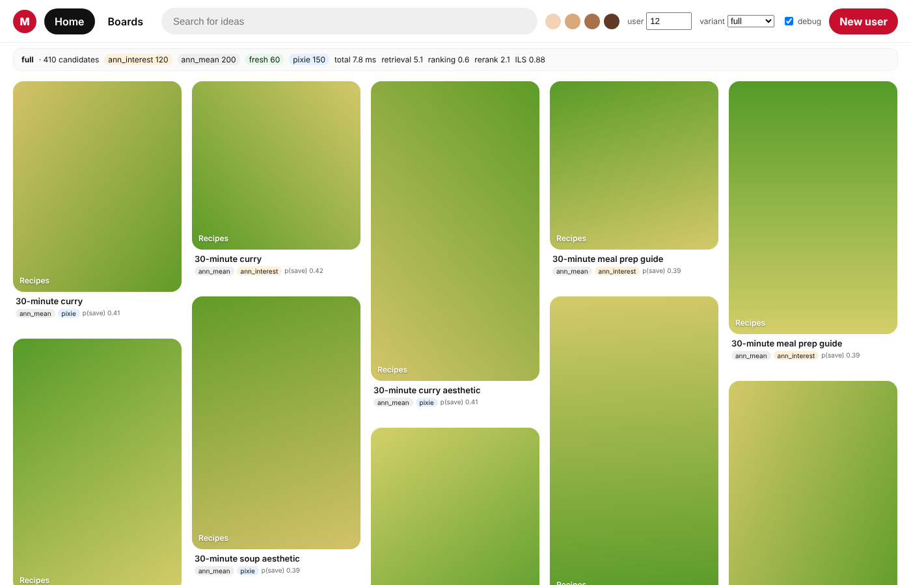
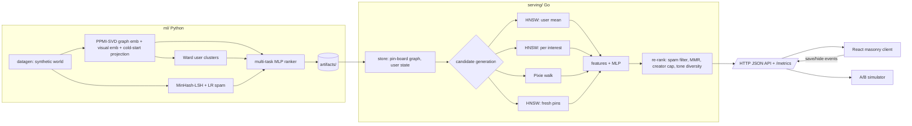

# Muse: a visual discovery engine, from candidate retrieval to an online A/B test

[](https://github.com/snehaislamm/muse/actions/workflows/ci.yml)

A small, end-to-end Pinterest-style home-feed recommender. It has a Go serving stack, a Python
ML pipeline, a React/TypeScript client, and an A/B harness that runs simulated users against the
live service. It is built to answer one question honestly: **when does a ranking change that looks
better offline actually make the feed better?**

> **All data is simulated.** A hidden ground-truth model (`ml/muse_ml/datagen.py`) generates
> pins, users, boards and engagement, so every offline metric can be checked against the truth.
> Numbers below are results *in this simulator*, not claims about any real product. This is an
> independent learning project and is not affiliated with Pinterest.



## In 30 seconds

**The problem.** Feed logs are position-biased: pins at the top get more saves just because people
see them. A ranker trained on raw logs learns "whatever used to be on top is good".

**What I did.** I estimated the bias from a 10% randomized-order slice of traffic (to within 0.013
of the hidden truth). I retrained the ranker with inverse-propensity weighting (IPW) and evaluated
it three ways: a naive offline metric, an unbiased IPS estimator, and a live simulated A/B test.

| | IPW ranker vs naive ranker |
|---|---|
| Naive offline metric (what most teams would look at) | **−2.9%** (would have rejected the better model) |
| IPS offline estimator | **+3.3%** (right direction; Kendall τ vs truth 0.90 vs 0.52 for naive) |
| Ground truth on the same logged sessions | +2.1% |
| Live simulated A/B, 4,000 users | **+14.1% saves** [+11.4, +17.1], **−21% hides** |

**It holds up.** Under 5 alternative simulator settings, including a misspecified bias curve, the
naive metric always pointed the wrong way and IPS always pointed the right way (`make robustness`).

**What I learned.** The online gain was 4x the offline estimate because the old feed rarely showed
fresh pins, which is exactly where the bias hurt most. An unbiased estimator still only sees what
the old system showed.

Everything else (retrieval, spam, serving, diversity, other A/B tests) is in
[docs/RESULTS.md](docs/RESULTS.md). The reasoning, including negative results, is in
[docs/DESIGN.md](docs/DESIGN.md).

## Why believe a simulator?

Fair question. Real engagement logs are private, and with real logs you can never check an offline
metric against the truth. That check is the point of this project. The usual risk is building the
world so your method wins. Here is how I tried to guard against that:
- The conclusions are re-tested under 5 hidden settings, including one the propensity model cannot
  represent exactly ([robustness table](docs/RESULTS.md#robustness-does-the-conclusion-depend-on-the-simulators-assumptions)).
- Results that went *against* my hypotheses are reported, not dropped: multi-interest retrieval did
  not beat a mean vector, re-ranking did not increase saves, and the ranker still under-serves fresh pins.
- The A/B users share the simulator with the training logs, so the absolute online lift is
  optimistic. The *direction* and the offline-vs-online gap are the transferable findings.

## What's in it

| Product problem | What Muse does | Where |
|---|---|---|
| Users have several unrelated interests | decayed mean embedding **plus** per-interest (Ward-clustered) retrieval | `ml/muse_ml/pinnersage.py`, `feed/engine.go` |
| Collaborative signal is in the board graph | Pixie-style random walks with restart, early stopping, multi-hit boosting | `serving/internal/pixie` |
| **Fresh pins have no engagement yet** (27% of held-out saves) | ridge projection from content to graph space, plus a dedicated fresh-pin ANN source | `embeddings.py`, `engine.go` |
| Brand-new users | onboarding topic picker, then a popularity pool; personalised after the first save | `api.go /v1/users`, `engine.go` |
| **Logged feedback is position-biased**: pins the old policy put on top get more actions just for being seen | propensities estimated from a 10% randomized-order slice, IPW-trained ranker, IPS counterfactual evaluation | `ml/muse_ml/debias.py` |
| Optimising clicks rewards clickbait | multi-task ranker (click / **save** / hide); utility = save + 0.3·click − 2·hide | `ml/muse_ml/ranker.py`, `rank/rank.go` |
| Spam rings repost stolen titles | MinHash-LSH near-duplicate clusters + logistic regression trained on a 15% "reviewed" sample | `ml/muse_ml/spam.py` |
| A feed of 20 near-copies | MMR diversity, creator cap | `serving/internal/rerank` |
| Skewed representation in beauty/fashion content | tone-range diversity in re-ranking + opt-in skin tone range filter (no inference of user attributes) | `rerank.go`, `web/src/App.tsx` |
| Training/serving skew | Python writes a feature/prediction fixture; a Go test requires agreement to 1e-4 (observed max diff 5e-7) | `rank/rank_test.go` |
| "Did it actually help?" | A/B simulator: hashed 50/50 split, Welch test, bootstrap CIs, guardrail metrics | `experiments/ab_sim.py` |

## Architecture



## Quickstart

```bash
make data        # ~40 s: synthetic world, embeddings, spam model, ranker -> artifacts/
make web         # React client -> web/dist
make serve       # http://localhost:8080
make test        # lint + 10 Python + 23 Go (race detector, parity, HTTP integration) + 3 TS tests
make eval        # offline replay (docs/RESULTS.md)
make robustness  # position-bias study under 5 simulator settings
make ab          # A/B simulation (needs `make serve`)
make loadtest
docker build -t muse . && docker run -p 8080:8080 muse
```

API: `GET /v1/feed?user=12&n=25&variant=full|full_naive|ranker|baseline&tone=0..4`,
`GET /v1/pins/{id}/related`, `GET /v1/search?q=`, `POST /v1/events {user,pin,type:save|hide|click}`,
`POST /v1/users {topics:[...]}`, `GET /v1/users/{id}/boards`, `GET /metrics` (Prometheus), `GET /healthz`.

## Layout

```
ml/          datagen, embeddings, pinnersage, features (the feature spec), ranker, debias, spam, run_pipeline.py, tests/
serving/     cmd/{server,offline-eval,loadtest}; internal/{store,ann,pixie,rank,rerank,search,feed,api,metrics}
web/         React + TypeScript client (masonry grid, close-up + related pins, boards, onboarding, tone filter, debug panel)
experiments/ ab_sim.py, position_robustness.py, results/ (A/B + eval JSON, v1 re-ranking sweep)
docs/        RESULTS.md, DESIGN.md (decisions, negative results), AI_USAGE.md, screenshots
```

## Known limitations / next steps

- **Cold-start conflation in the ranker:** a new pin with 0 saves scores like a bad old pin. Catalogue
  coverage falls from 61% (baseline) to 32% (full), and fresh-pin saves fall too. Next steps are
  conditioning popularity on pin age (or dropping it for pins under N days old) and a small
  exploration slot, measured with the same A/B harness.
- Propensities are estimated from randomized traffic, which costs engagement. Regression-EM
  (Wang et al. 2018) can estimate them from regular logs. With known ground truth, the two could be
  compared directly.
- The per-interest retrieval did not beat the mean vector on recall in this world (DESIGN.md §2).
  It is kept for candidate diversity.
- Embeddings are batch-built. Online inserts into the fresh HNSW index are supported, but pin
  ingestion is not exposed over the API.
